# Exploratory Testing Notes

|                 |                                                                            |
| --------------- | -------------------------------------------------------------------------- |
| **Tester**      | Tangi Fominyam                                                             |
| **Date**        | 12 October 2026                                                            |
| **Time box**    | 60 minutes                                                                 |
| **Environment** | Google Chrome 154.0.8037.58, Windows 11, https://tfl.gov.uk/plan-a-journey |

## Charter

Explore the Journey Planner widget using the journeys from the brief, to find out how it actually
behaves and what the automated tests need to look for. Confirm or correct the interpretations in
`REQUIREMENTS.md` (A2 to A5).

## Session notes

Write what you did and what you saw as you go. Add a
screenshot to `docs/images/` for anything worth showing and reference it here.

### Before the widget: cookie banner

- What appears when the page first loads? Just the landing page plus a cookie banner 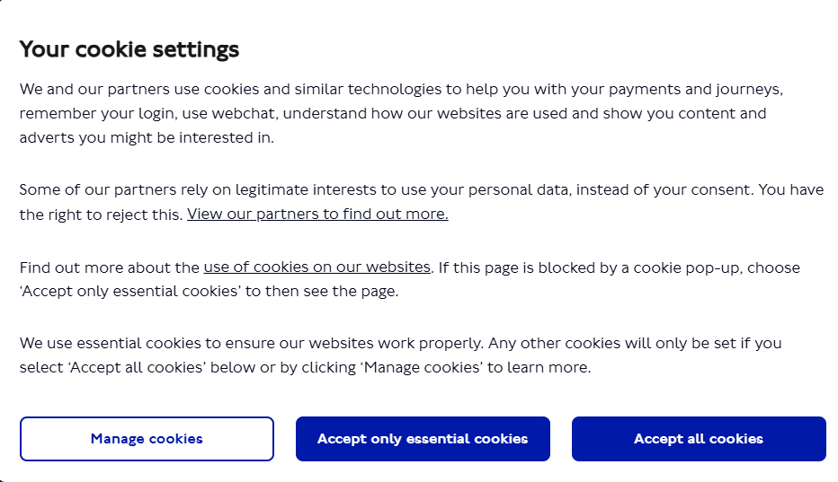.
- Which buttons does it offer? "Manage cookies", "Accept only essential cookies" and "Accept all cookies" (01-cookie-banner.png)
- Which one did you click? "Accept only essential cookies"

### REQ-08: planning Leicester Square to Covent Garden with autocomplete

- How many characters did you type before suggestions appeared? 1-character for general suggestions, 3-Characters for Leicester Square and 2-characters for Covent Garden (02-autocomplete-from.png and 03-autocomplete-to.png)
- What did the suggestion list look like? Was the station easy to pick out? Suggestion list is a dropdown menu with different suggestions.Yes station was easy to pick out(02-autocomplete-from.png and 03-autocomplete-to.png)
- What did the From and To fields show after selecting? Showed the desired stations (02-autocomplete-from.png and 03-autocomplete-to.png)
- What happened when you clicked to plan the journey? Did the page URL change?Journey results were populated and the page URL changed (https://tfl.gov.uk/plan-a-journey/results?InputFrom=Leicester+Square+Underground+Station&FromId=1000135&InputTo=Covent+Garden+Underground+Station&ToId=1000056)(04-results-walk-cycle.png)

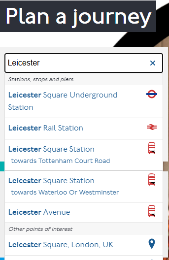

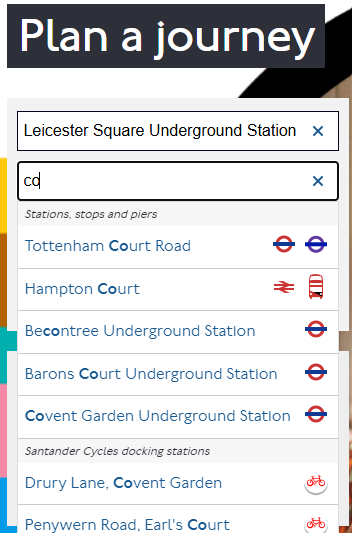

### REQ-09: walking and cycling times

- Where on the results page are the walking and cycling times shown? Bottom of the page (04-results-walk-cycle.png)

- What format are they in (for example "8mins", "8 minutes")? A number followed by "mins", for example "6 mins" for walking and "1 mins" for cycling (04-results-walk-cycle.png)

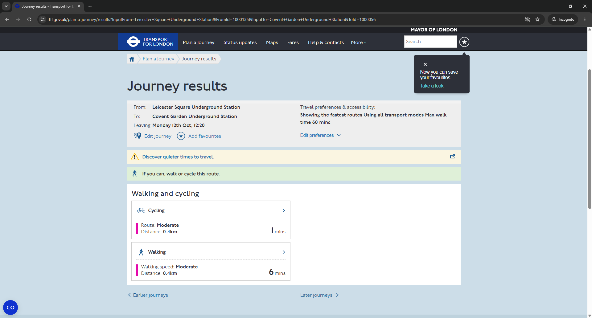

### REQ-10 and REQ-11: Edit preferences, least walking, journey time

- Where is "Edit preferences"? What options does it open? It is under Travel preferences & accessibility (05a-edit-preferences-open.png)
- What exactly is the "least walking" option called? "Routes with least walking" (05b-least-walking-selected.png)
- What changed after "Update journey"? New journey result with the edited preference and accessibility information is populated.(06-updated-journey-time.png)
- Where is the journey time shown, and in what format? on the right of each journey option and the format is a number followed by "mins", for example "11 mins" (06-updated-journey-time.png)

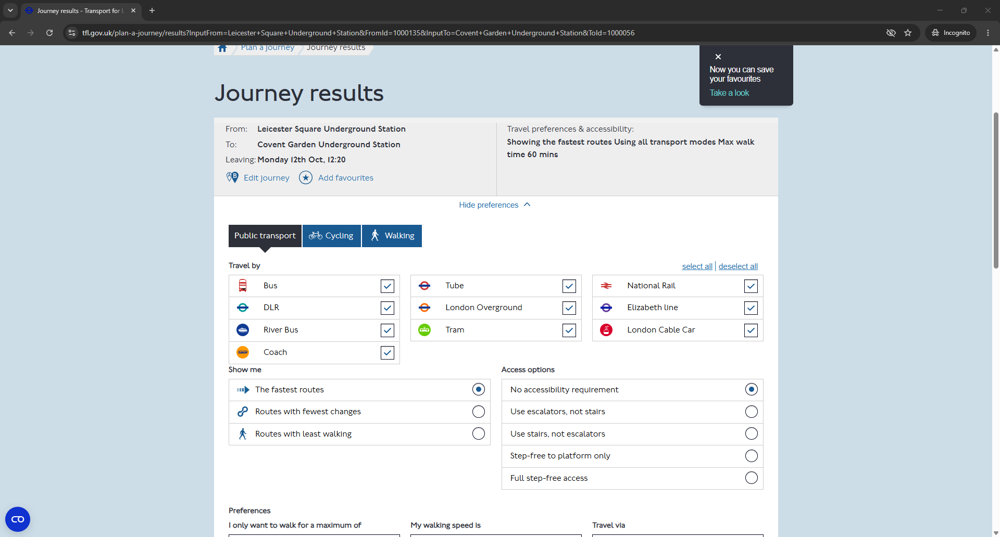

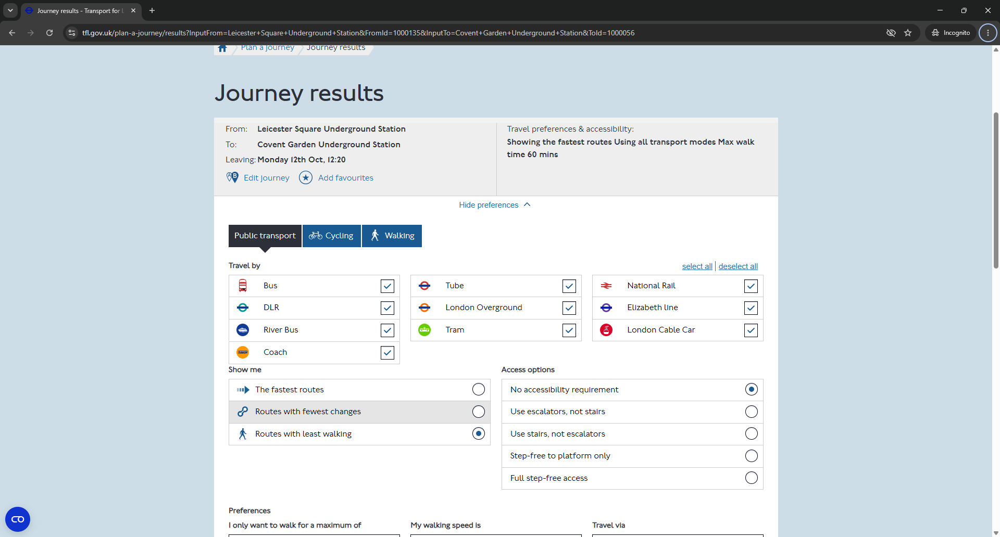

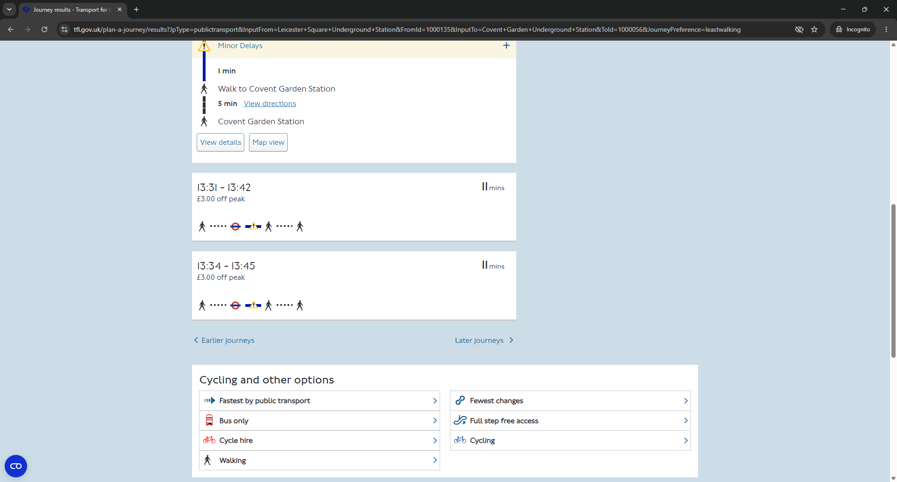

### REQ-12 and REQ-13: View Details and access information

- Where is "View Details"? What opens when you click it? At the bottom of the first journey option. Detailed journey with access info is populated (07a-view-details.png)
- List every piece of access information shown for Covent Garden Underground Station. "Complete" access information is the icon tooltips plus the Accessibility details list. That resolves A4.
    - Step icons at Covent Garden (hover to see the tooltip): "Up stairs", "Up lift", "Level walkway" (07b, 07c, 07d)
    - Accessibility details for the journey: total walking time "10 minutes", "2 sets of stairs down", "1 escalator down", "1 set of stairs up", "1 level walkway" (07e-accessibility-details.png)

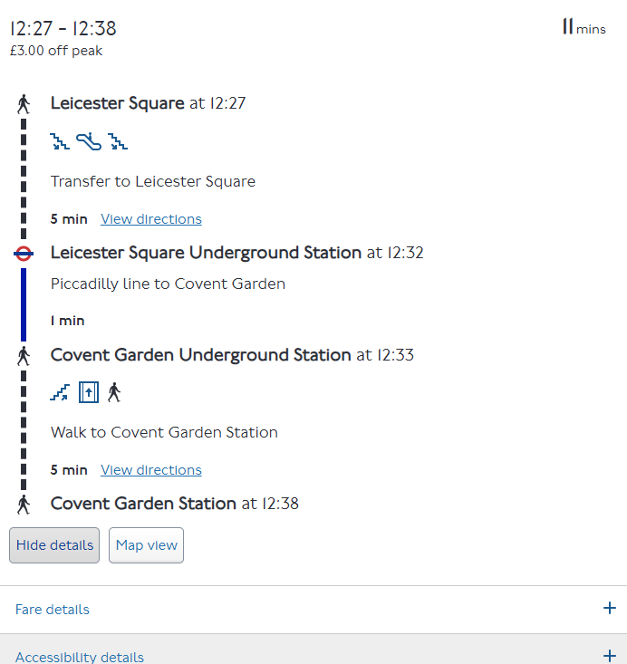

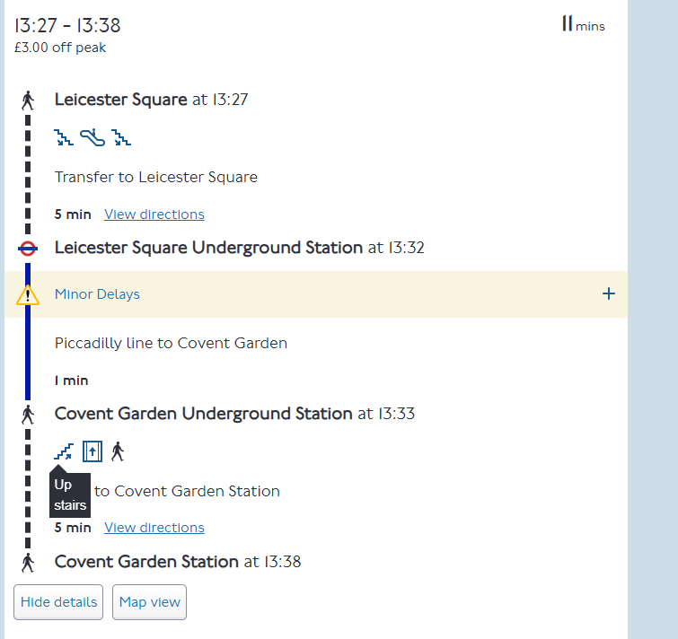

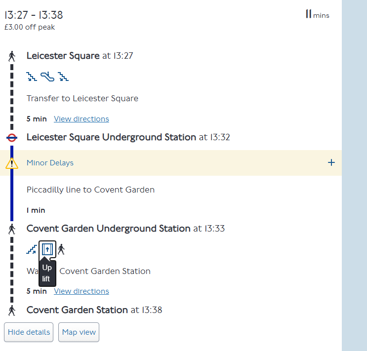

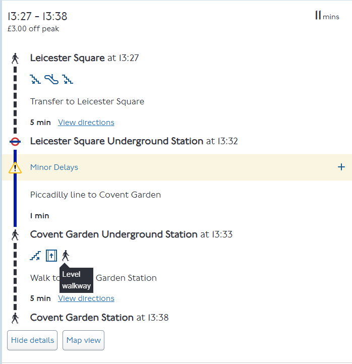

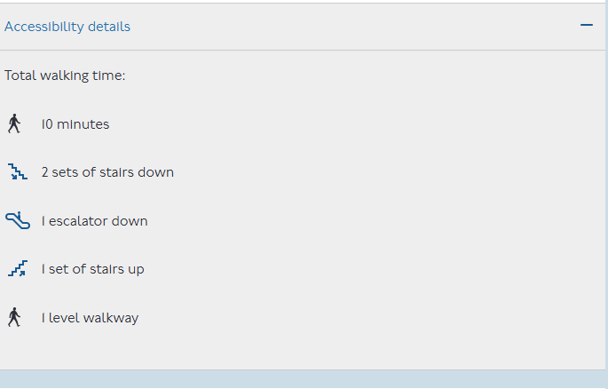

### REQ-14: invalid locations

| From                                 | To                                | Result                                             | Screenshots |
| ------------------------------------ | --------------------------------- | -------------------------------------------------- | ----------- |
| Xqzpwv123                            | Covent Garden Underground Station | No results; "did you mean" list with 2 suggestions | 08a, 08b    |
| Leicester Square Underground Station | Zzqxvt999                         | No results; "did you mean" list with 1 blank entry | 09a, 09b    |
| Abcxyz111                            | Qwzzpp222                         | No results; "did you mean" list for From only      | 10a, 10b    |

What I saw in each case:

- **Invalid From (Xqzpwv123):** the page says "We found more than one location matching 'Xqzpwv123'" and offers City of Westminster, 123Vegan and Royal Borough of Greenwich, V12 Motorsport Store. FromId in the URL is empty.
- **Invalid To (Zzqxvt999):** the page says "We found more than one location matching 'Zzqxvt999'" but lists a single blank entry showing only a comma. ToId in the URL is empty.
- **Both invalid (Abcxyz111 / Qwzzpp222):** the page says "We found more than one location matching 'Abcxyz111'" and lists suggestions such as ABC Pharmacy and Abchurch Lane. It only asks about the From value. FromId and ToId in the URL are both empty.

Found later, while automating REQ-14 (13 Oct 2026):

- In the both-invalid case the page also holds a "more than one location matching 'Qwzzpp222'" message for the To value, but it is hidden. Only the From message is shown. The tests therefore look for the message about one named location, not any message.
- The both-invalid list ends with a seventh entry that is blank apart from a comma, the same as Issue 2.

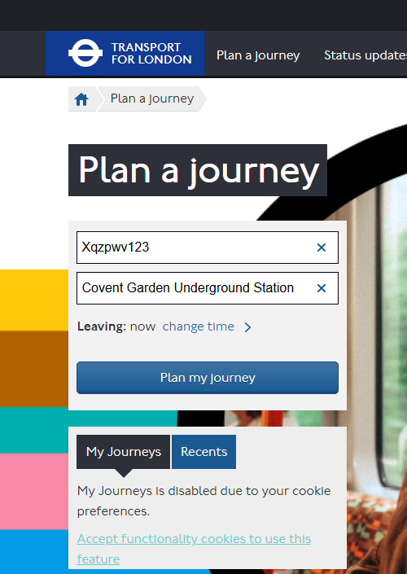

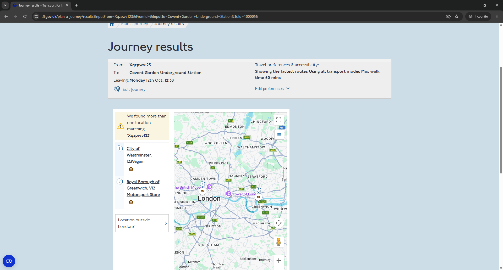

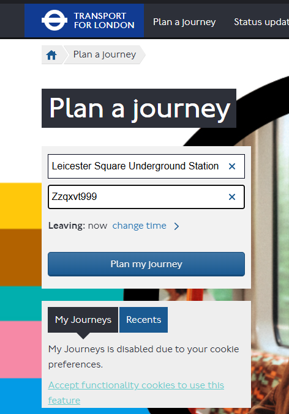

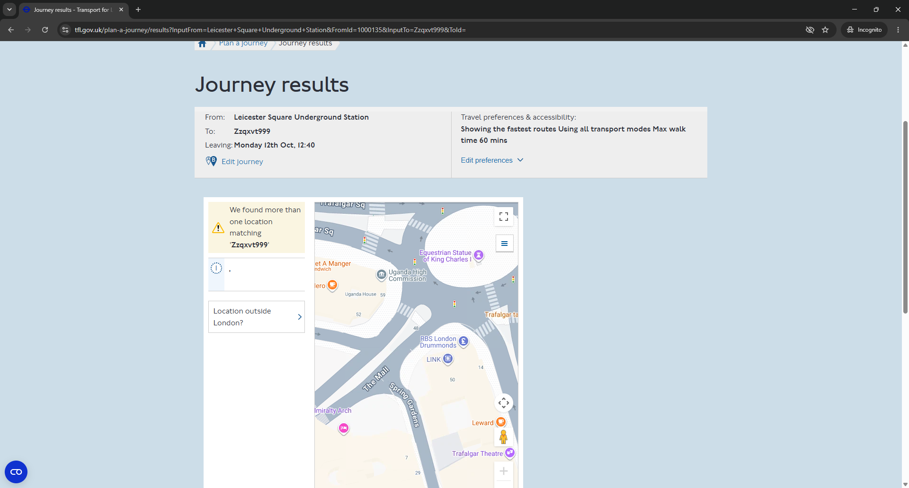

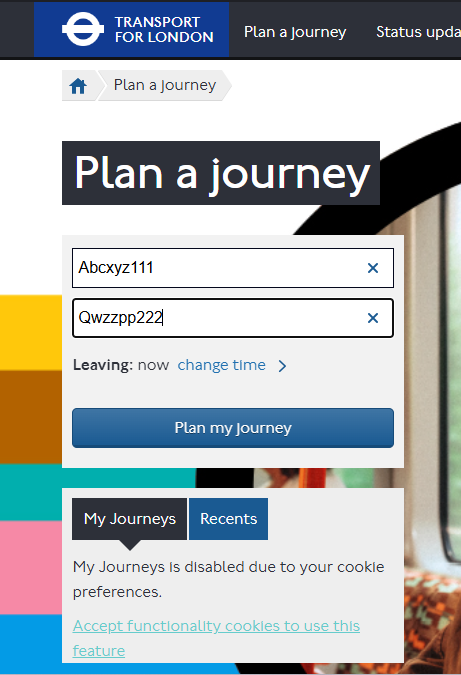

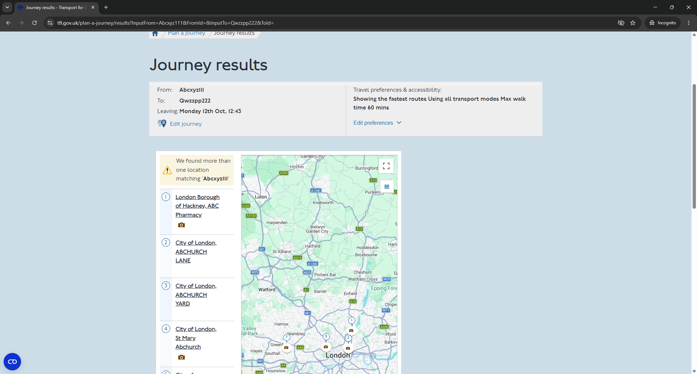

### REQ-15: no locations

- What happens when you plan a journey with both fields empty? Error message shown. (11-no-locations.png)
- Exact wording of any message shown: "The From field is required." and "The To field is required." (11-no-locations.png)

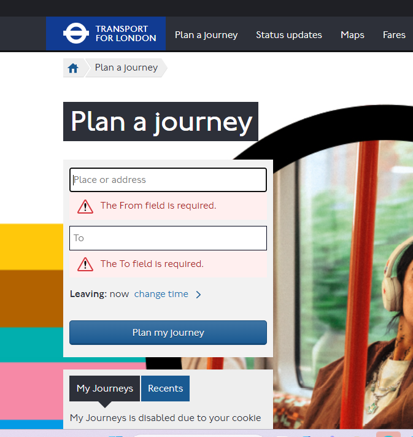

## Issues and observations

Anything that looked wrong, slow, confusing or inaccessible, even if it's outside the brief.

| #   | Issue                                                                   | Severity | Evidence |
| --- | ----------------------------------------------------------------------- | -------- | -------- |
| 1   | Lift shown in the step icons but missing from the accessibility summary | Medium   | 07c, 07e |
| 2   | "More than one location" message with a single blank entry              | Medium   | 09b      |
| 3   | Nonsense input is matched to real places                                | Low      | 08b, 10b |
| 4   | Cycling time reads "1 mins"                                             | Low      | 04       |
| 5   | Cookie overlay can stay on screen after accepting cookies               | Medium   | 12       |

### Issue 1: lift shown in the step icons but missing from the accessibility summary

- **Steps:** plan Leicester Square Underground Station to Covent Garden Underground Station with "Routes with least walking", open View Details on the first journey, hover over the Covent Garden icons, then expand Accessibility details.
- **Expected:** the summary lists the same facilities as the step icons.
- **Actual:** the Covent Garden step shows an "Up lift" icon, but the Accessibility details summary lists stairs, an escalator and a level walkway, with no lift.
- **Why it matters:** someone who relies on a lift and reads only the summary could get the wrong picture of the station.
- **Evidence:** 07c-access-up-lift.png, 07e-accessibility-details.png

### Issue 2: "More than one location" message with a single blank entry

- **Steps:** enter Leicester Square Underground Station as From, type "Zzqxvt999" as To without picking a suggestion, then click Plan my journey.
- **Expected:** a message that matches the list shown, for example "We couldn't find 'Zzqxvt999'".
- **Actual:** the page says "We found more than one location matching 'Zzqxvt999'", but the list has one entry, and that entry is blank apart from a comma.
- **Evidence:** 09b-invalid-to-result.png
- **Also seen:** at the end of the both-invalid list (Abcxyz111 / Qwzzpp222), found during the automated run on 13 Oct 2026.

### Issue 3: nonsense input is matched to real places

- **Steps:** type "Xqzpwv123" or "Abcxyz111" as a location and plan the journey.
- **Expected:** this looks like deliberate fuzzy matching, so it's recorded as an observation rather than a defect.
- **Actual:** "Xqzpwv123" returns 123Vegan and V12 Motorsport Store; "Abcxyz111" returns ABC Pharmacy and Abchurch Lane. The widget never says "no results".
- **Impact on testing:** the REQ-14 tests can't assert "no results found". They assert that no journey results appear and that the "more than one location" message does.
- **Evidence:** 08b-invalid-from-result.png, 10b-invalid-both-result.png

### Issue 4: cycling time reads "1 mins"

- **Steps:** plan Leicester Square Underground Station to Covent Garden Underground Station and look at the Walking and cycling section.
- **Expected:** "1 min".
- **Actual:** "1 mins".
- **Evidence:** 04-results-walk-cycle.png

### Issue 5: cookie overlay can stay on screen after accepting cookies

- **Found:** during an automated run of REQ-08/09 on 13 Oct 2026, not during the manual session.
- **Steps:** open Plan a journey in a fresh browser and click "Accept only essential cookies".
- **Expected:** the banner and the dark layer behind it both disappear.
- **Actual:** the banner went (the page shows "My Journeys is disabled due to your cookie preferences"), but the dark layer stayed for more than 15 seconds and blocked every click on the page.
- **How often:** more often than it first looked. 1 of 5 scenarios in the regression run on 13 Oct, 3 of 6 on 14 Oct, and 4 of 8 in a fully logged headed run later on 14 Oct (all 4 on the Plan a journey page). It looks like timing, so it may be hard to reproduce by hand.
- **Why it matters:** a user would see a dimmed page that ignores clicks until they reload.
- **Not only the first page:** in a headless run on 14 Oct the layer came back and stuck on the results page, long after the cookies had been accepted, and blocked the next click.
- **How the tests handle it:** if the layer is still there 10 seconds after accepting, the test reloads the page and writes a line to the test output, so it is visible rather than hidden. A Playwright locator handler does the same on any later page, whenever the layer appears before a click.
- **Evidence:** 12-cookie-overlay-stuck.png

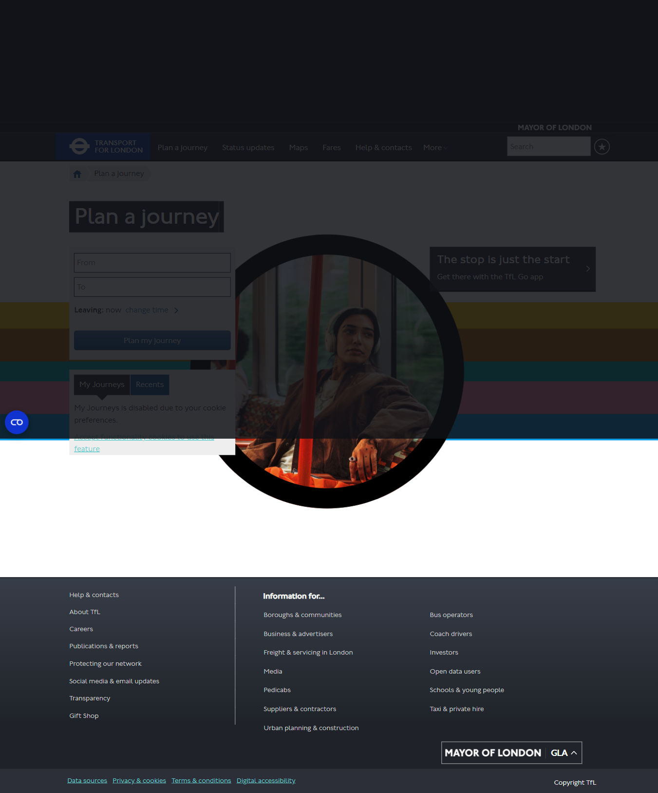

## Questions raised

Anything you couldn't answer from the page.

- Does the Accessibility details summary cover the whole journey or just one station? It looks like the whole journey (stairs and escalator down at Leicester Square, stairs up and walkway at Covent Garden), but the page doesn't say.
- Why does the lift appear in the Covent Garden step icons but not in the Accessibility details summary? (Issue 1)
- When both locations are invalid, does the To value get its own "did you mean" step once the From value is chosen?

## Outcome

Which of A2 to A5 in `REQUIREMENTS.md` are now resolved, and how.

| ID  | Status                  | How                                                                                              |
| --- | ----------------------- | ------------------------------------------------------------------------------------------------ |
| A2  | Resolved                | Times are in the "Walking and cycling" section of the results page, e.g. "6 mins"                |
| A3  | Resolved                | Shown on the right of each journey, e.g. "11 mins"; the test checks format and range             |
| A4  | Resolved                | Step icon tooltips plus the Accessibility details list                                           |
| A5  | Resolved, with a change | "More than one location" message and no results; test data in REQUIREMENTS.md 2.4 needs updating |
